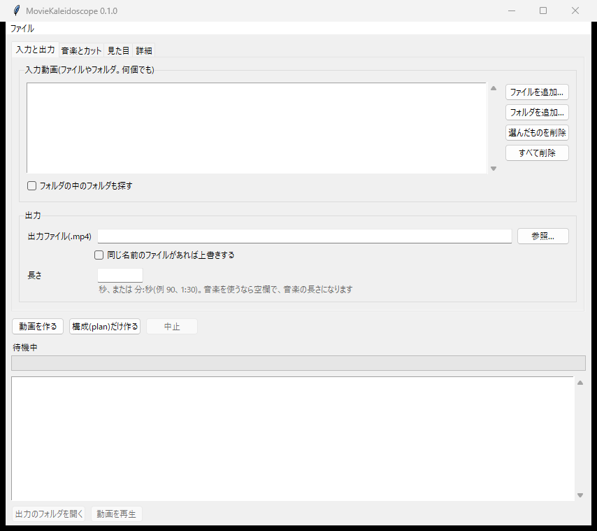
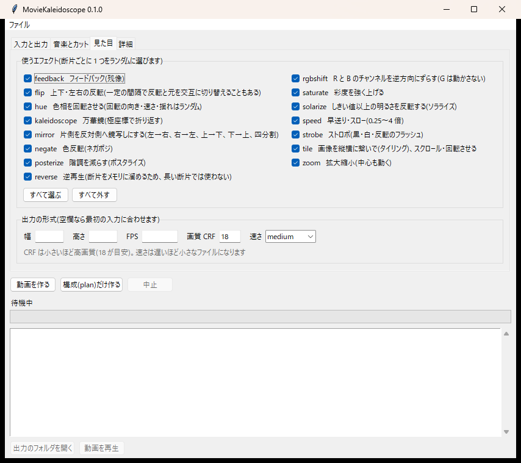

# MovieKaleidoscope

用意した動画を切り貼りして、サイケデリックな動画を自動で作るコマンドラインツールです。生成 AI は使いません。

> 本プロジェクトのコードおよびドキュメントは、すべて AI (Claude) によって書かれています。ライセンスは [Apache License 2.0](LICENSE) です。

入力動画からランダムに断片を切り出し、反転・ミラー・ソラライズ・RGB シフト・万華鏡などのエフェクトをかけ、つないで、指定した長さの動画にします。BGM を渡すと、その BPM に合わせてカットが切り替わります。

```
mkaleido -i ./clips -o out.mp4 -d 60 --audio bgm.wav
```

- 同じ設定と seed なら、同じ構成の動画になります(構成は JSON の「plan」として保存され、あとから再生成も編集もできます)。
- 動画は 1 本でも、フォルダでも、混ぜても指定できます。壊れたファイルは警告を出してスキップします。
- 画面で操作する GUI もあります(`mkaleido-gui`。[GUI の使い方](#gui)を参照)。

## 必要なもの

- Python 3.10 以上
- ffmpeg と ffprobe(4.4 以上。新しいほど安心です)

### インストール

**Windows**(PowerShell):

```powershell
winget install Gyan.FFmpeg          # ffmpeg。インストール後はターミナルを開き直す
cd MovieKaleidoscope
python -m pip install -e .
mkaleido --version
```

**macOS**: `brew install ffmpeg` のあとに `python3 -m pip install -e .`
**Linux**: `sudo apt install ffmpeg` のあとに `python3 -m pip install -e .`

ffmpeg が PATH にない場合は、`--ffmpeg C:\tools\ffmpeg\bin\ffmpeg.exe` で指定するか、環境変数 `FFMPEG_BIN` / `FFPROBE_BIN` を設定します。

`mkaleido --version` を実行しても `用語 'mkaleido' は...認識されません` のようなエラーになる場合は、ffmpeg ではなく **`mkaleido` / `mkaleido-gui` 自体が PATH に入っていない**状態です。多くは次のいずれかで直ります。

- `python -m pip install -e .` を実際に実行したターミナルと、`mkaleido` を打つターミナルが違う Python を指している(複数バージョンの Python が入っている、仮想環境を有効化していない、など)。`python -m moviekaleidoscope.cli --version` が通るか確認し、通るならこちらが原因です。
- Python インストーラーで「Add python.exe to PATH」にチェックを入れていない、または `pip install` がユーザー権限用のフォルダにスクリプトを入れた。`python -m site --user-base` で出たパスの下の `Scripts` フォルダ(例: `%APPDATA%\Python\Python312\Scripts`)をユーザー環境変数 `PATH` に追加してください。
- インストール直後で、開いたままのターミナルに PATH の変更が反映されていない。新しい PowerShell ウィンドウを開き直してください。
- PATH を直したくない・一時的に試すだけなら、`python -m moviekaleidoscope.cli`(`mkaleido` の代わり)/ `python -m moviekaleidoscope.gui`(`mkaleido-gui` の代わり)でも起動できます。

## ファイルの構成

```
MovieKaleidoscope/
├── src/moviekaleidoscope/
│   ├── cli.py           コマンドライン(mkaleido)のエントリポイント
│   ├── api.py            generate() / render_plan() など中心となる処理
│   ├── config.py          設定ファイル(YAML)の読み込みと検証
│   ├── planner/           乱数で「plan」(どの動画のどこを、どのエフェクトで使うか)を作る
│   ├── render/            plan を実際の映像にする(ffmpeg 呼び出し、並列処理)
│   ├── effects/           各エフェクト(万華鏡、反転、ソラライズなど)の実装
│   ├── audio/             BGM の BPM 解析
│   ├── media/             入力動画の検証、ffmpeg/ffprobe のラッパー
│   ├── util/              電源プランの切り替え、メモリ見積り、進捗表示など
│   └── gui/               GUI(mkaleido-gui)。tkinter 製
├── tests/
│   ├── unit/              ffmpeg なしで動く速いテスト
│   ├── integration/       実際に ffmpeg を使うテスト
│   └── tools/              テスト用のダミー動画・音声を作る道具
├── docs/
│   ├── SPEC.md            仕様と設計判断の記録
│   ├── TESTING.md         テストの状況、未確認の項目
│   └── images/             この README のスクリーンショットなど
├── sample/                生成済みのサンプル動画と plan
├── config.example.yaml    設定ファイルの全項目サンプル
└── pyproject.toml         パッケージ定義(`mkaleido` / `mkaleido-gui` コマンドなど)
```

## GUI

コマンドを書かずに、画面で操作できます。

### 起動

```
mkaleido-gui                      # または python -m moviekaleidoscope.gui
```

tkinter が必要です(Windows と macOS の公式の Python には含まれます。Debian / Ubuntu では `sudo apt install python3-tk`)。

### 画面

タブは上から「入力と出力」「音楽とカット」「見た目」「詳細」の 4 つです。



| タブ | できること |
|---|---|
| 入力と出力 | 動画やフォルダを追加し、出力ファイルと長さを決める |
| 音楽とカット | 音楽を選ぶ(BPM は自動検出。違うときは手入力)。カットの方式と長さを選ぶ |
| 見た目 | 使うエフェクトを選ぶ。出力の幅・高さ・FPS・画質を決める |
| 詳細 | シード、並列数、ffmpeg の場所 |

「見た目」タブでは、使うエフェクトをチェックボックスで選び、出力の形式(幅・高さ・FPS・画質)を決めます。



### 操作の流れ

1. 「入力と出力」タブで、`ファイルを追加...` / `フォルダを追加...` から動画を指定し、出力ファイルと長さを決める。
2. 必要なら「音楽とカット」タブで BGM を指定する(省略すると固定長のカットになる)。
3. 「見た目」タブで使うエフェクトと出力の形式を選ぶ(省略時は全エフェクト・入力に合わせた形式)。
4. 画面下の「動画を作る」を押す。進捗バーが進み、「中止」でいつでも止められる。
5. 終わったら「出力のフォルダを開く」「動画を再生」が使える。

- 「構成(plan)だけ作る」と、メニューの「plan から動画を作り直す」は、コマンドライン版の `--plan-only` と `--from-plan` と同じです。
- メニューの「設定を保存 / 開く」は、コマンドライン版と同じ設定ファイル(YAML)を読み書きします。GUI にない設定(エフェクトの重みなど)は、読み込んだファイルのものが保持されます。
- 終了時の設定は記憶され、次の起動で復元されます(「上書きする」は除く)。

## 使い方

### 基本

```
mkaleido -i 動画A.mp4 -i ./フォルダ -o out.mp4 -d 60
```

| オプション | 内容 |
|---|---|
| `-i PATH` | 入力ファイルまたはフォルダ(何度でも指定可)。`--recursive` でサブフォルダも探索 |
| `-o FILE` | 出力ファイル(`.mp4`)。既にあるときは `-y` で上書き |
| `-d T` | 出力の長さ。秒、または `mm:ss`。音声があれば省略でき、音声の長さになります |
| `--seed N` | 乱数のシード。省略すると自動で決まり、ログと plan に残ります |
| `--width N --height N --fps N` | 出力の形式。省略すると最初の入力に合わせます |

出力の解像度と FPS は、既定では**最初の入力**に合わせます(ただし解像度は最大 1080p まで。4K で作りたいときは `--width 3840 --height 2160` のように指定します。FPS は、可変フレームレートの動画などで半端な値になる場合、24・25・29.97・30・60 などの近い標準の値に丸めます)。形が違う入力は、拡大して全面を埋めて、はみ出た部分を切り落とします(黒帯は入りません)。出力は H.264 の mp4 で、色空間は BT.709 に統一されます。

### 断片の長さ(カット)

| 指定 | 内容 |
|---|---|
| 何も指定しない | 音楽か `--bpm` があれば拍に合わせ、なければ 2 秒の固定長 |
| `--cut-length 3` | 3 秒の固定長 |
| `--cut-random 1:4` | 1〜4 秒のランダム |
| `--beats 4` / `--beats 1,2,4` | 拍の数で指定(複数ならランダムに選ぶ)。音楽の BPM に合わせて切り替わります |

音楽があっても `--cut-length` や `--cut-random` を指定すれば、音楽を無視してカットできます。

### 音楽に合わせる

```
mkaleido -i ./clips -o out.mp4 --audio bgm.wav --beats 2,4
```

- BPM と最初の拍の位置は、音声から自動で検出します(テンポが一定の曲が前提です)。結果はログに表示されます。
- 検出に失敗したとき(拍のない音、15 秒未満の音声など)は、警告を出して固定長のカットにします。`--cut-mode beat` を明示していた場合はエラーになります。
- `--bpm 128` で BPM を手動指定できます(検出は行いません)。音声がなくても指定でき、その場合は音声なしの動画が拍に合ってカットされます。
- 倍テンポ・半テンポや 1.5 倍のテンポを取り違える曲(87 と 174、95 と 142.5 など、どちらも拍に乗る曲)は、`--bpm` で指定してください。DJ ミックスのようにテンポが途中で変わる音源や、冒頭に拍のない曲も、検出がうまくいかないことがあります。
- 音声の途中から使うには、設定ファイルの `audio.start`(秒)を指定します。
- 音声が出力より短いときは、残りは無音になります。長いときは出力の長さで切ります。

BPM が分かっているとき、エフェクトの動きも拍に合います(周期が拍単位になる、拍の頭で強くなる、`tile` が「N 拍で 1 タイル」スクロールする、など)。

## エフェクト

断片ごとに 1 つを、重みつきでランダムに選びます。パラメータもランダムで、多くは断片の中で時間変化します。

| 名前 | 内容 |
|---|---|
| `flip` | 上下・左右の反転(一定間隔で元と交互に切り替えることも) |
| `negate` | 色反転(ネガポジ)。反転の強さが動く |
| `mirror` | 片側を反対側に鏡写し(左右・上下・四分割)。軸が動く |
| `solarize` | しきい値以上の明るさを反転(一部のチャンネルだけのことも) |
| `rgbshift` | R と B を逆方向にずらす |
| `hue` | 色相の回転 |
| `saturate` | 彩度を強く上げる |
| `posterize` | 階調を減らす |
| `speed` | 早送り・スロー(0.25〜4 倍)。加速・減速も |
| `reverse` | 逆再生(10 秒を超える断片には使いません) |
| `zoom` | 拡大縮小(中心も動く) |
| `kaleidoscope` | 万華鏡 |
| `strobe` | 黒・白・反転のフラッシュ |
| `feedback` | 残像(直前の画面を拡大・回転・減衰させて重ねる) |
| `tile` | 画像を縦横に並べて、スクロール・回転させる |

```
mkaleido --list-effects                       # 一覧とパラメータの範囲
mkaleido ... --effects kaleidoscope,tile      # この中から選ぶ
mkaleido ... --exclude-effects reverse,strobe # これを除く
```

出現の重みやパラメータの範囲は、設定ファイルの `effects.weights` / `effects.params` で変えられます。

## 設定ファイル

オプションが多いときは YAML にまとめられます(`config.example.yaml` に全項目の例があります)。コマンドラインで指定した値が、設定ファイルより優先されます。

```yaml
inputs: [./clips]
output: ./out/result.mp4
duration: 90
audio: {file: ./bgm.wav}
cut: {beats: [2, 4]}
video: {crf: 18, preset: medium}
effects:
  exclude: [reverse]
  weights: {kaleidoscope: 2.0}
```

```
mkaleido -c settings.yaml
mkaleido -c settings.yaml --dump-config      # 解決後の設定を確認
```

設定ファイル内の相対パスは、設定ファイルのあるフォルダが基準です。

## plan(再現と編集)

生成のたびに、構成(どの動画のどこを、どの長さで、どのエフェクトで使うか)が `<出力>.plan.json` に保存されます。

```
mkaleido -i ./clips -o out.mp4 -d 60 --plan-only          # 構成だけ作る(映像は処理しない)
mkaleido --from-plan out.mp4.plan.json -o again.mp4       # 同じ構成で作り直す
```

- plan は読みやすい JSON です。エフェクトの種類やパラメータを手で書き換えてから `--from-plan` で作り直せます。
- `--from-plan` では、素材やカットに関わるオプションは指定できません(plan の内容が使われます)。
- 同じ seed・入力・設定なら、同じ plan ができます。

## 性能の目安

24 論理コアの PC での測定です(Windows は ffmpeg 8.1.2 / 9.1、WSL2 は ffmpeg 4.4.2)。

| 条件 | Windows | WSL2 |
|---|---|---|
| 1280×720・60 秒・全エフェクト既定(`preset: medium`)、`--jobs 1` | 約 24 秒 | 約 29 秒 |
| 同上、`--jobs 4` | 約 11〜12 秒 | 未測定 |
| 同上、`--jobs 12` | 約 10〜11 秒 | 約 10 秒 |
| 1920×1080・60 秒・全エフェクト既定、`--jobs 12` | 約 21 秒 | 約 18 秒(ピークメモリ約 1.4GB) |
| 同上で音楽に合わせたカット(90 秒、72 クリップ、`preset: veryfast`) | 未測定 | 約 11 秒 |

上はすべて CPU エンコード(`video.backend: software`)の数値です。GPU の NVENC が使える場合(`video.backend: auto`、既定)は、同じ 1280×720・60 秒の条件で `--jobs 4` 約 10 秒、`--jobs 8` 約 9 秒、`--jobs 12` 約 9 秒(コンシューマ GPU 1 枚、2026-11-22 測定)。CPU 側を圧迫しないぶん有利ですが、このダミー素材では software との差はそれほど大きくありません。

`--jobs N` で並列数を指定します。既定は論理コア数の半分ですが、`video.backend` が(`auto` で解決した結果も含めて)`nvenc` で、かつフレーム単位で処理するエフェクト(万華鏡・feedback・tile など)を使わない場合は論理コア数の 3/4 まで増やします(nvenc は CPU をあまり使わないため)。空きメモリに収まる数まで自動で減らすこともあり、そのときはログに出ます(4K の入力は 1 つあたり約 1.5GB を見込みます)。重い処理は万華鏡(1 フレーム 14ms、720p)とタイリングです。`reverse` は断片をメモリに溜めるため、1080p・10 秒の断片で約 1GB(計算値)使います(並列数が多いと重なります)。

GPU の NVENC は、同時に開けるエンコーダのセッション数に機種・ドライバ依存の上限があります。既定のジョブ数がその上限を超えていた場合、動画の生成中に自動で同時実行数を 1 つずつ減らして再試行するので(ログに警告が出ます)、通常は `--jobs` を手で調整する必要はありません。

レンダリング中は Windows の電源プランを一時的に「高パフォーマンス」に切り替えます(終了時に元に戻します)。バッテリー駆動時などに切り替えたくない場合は、設定ファイルで `runtime.power_plan: false` にしてください。

## 制限

- HDR や 10bit の動画は、トーンマッピングなしで 8bit の SDR として扱います(色味が変わることがあります)。
- BPM 検出は、テンポが一定の曲が前提です。生演奏のようにテンポが揺れる曲には向きません。2 分を超える曲でわずかなテンポの誤差が気になる場合は、`--bpm` を小数で指定してください。
- スロー再生は、フレームを複製するだけです(補間はしません)。
- 音声の加工(フェードなど)はしません。入力動画の音声は使いません。
- トランジションはハードカットのみです。

## うまくいかないとき

| 症状 | 対処 |
|---|---|
| `ffmpeg が見つかりません` | インストール後にターミナルを開き直す。または `--ffmpeg` で指定 |
| `mkaleido` / `mkaleido-gui` が見つかりません | [インストール](#インストール)の PATH の節を参照。`python -m moviekaleidoscope.cli` / `python -m moviekaleidoscope.gui` でも代用できます |
| `有効な入力動画がありません` | 入力が壊れているか、0.5 秒未満です。警告にスキップの理由が出ています |
| 途中で止まった・失敗した | `-v` で詳細を表示。`--keep-temp` で作業フォルダを残して確認できます。失敗したクリップは、別の入力で 1 回だけやり直します |
| 音楽とカットが合わない | ログの BPM を確認。違うときは `--bpm` で指定 |
| 終了コード | 0 正常、1 実行時エラー、2 引数・設定の誤り、3 入力なし、4 ffmpeg なし、130 中断 |

## 開発

```
python -m pip install -e ".[dev]"
python -m pytest -m "not integration"     # ffmpeg なしで動く速いテスト(約 30 秒)
python -m pytest                          # すべて(ffmpeg が必要。数分かかります)
```

- **テストの状況と、未確認の項目(Windows での確認手順を含む)は [`docs/TESTING.md`](docs/TESTING.md) にあります。**
- 仕様は [`docs/SPEC.md`](docs/SPEC.md) にあります。設計の判断と、実測に基づく決定(色空間、タイムスタンプ、BPM 検出)の理由が書かれています。
- 構成: 入力の検証 → BPM 解析 → **Planner**(乱数で plan を作る)→ **Renderer**(plan を映像にする)。Planner と Renderer は plan だけで繋がっていて、レンダリング時に乱数は使いません。
- テストの素材は、実行時に ffmpeg と numpy で生成します(リポジトリには置きません)。映像のカット時刻と音声のクリック位置を、出力ファイルから直接測る同期テストがあります。
- 新しいエフェクトは `src/moviekaleidoscope/effects/` にクラスを 1 つ書いて、`registry.py` に登録します。
